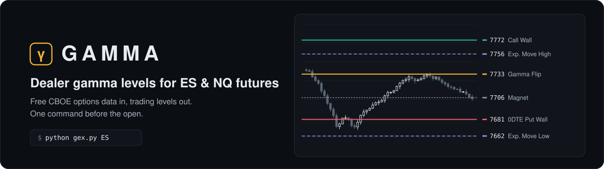
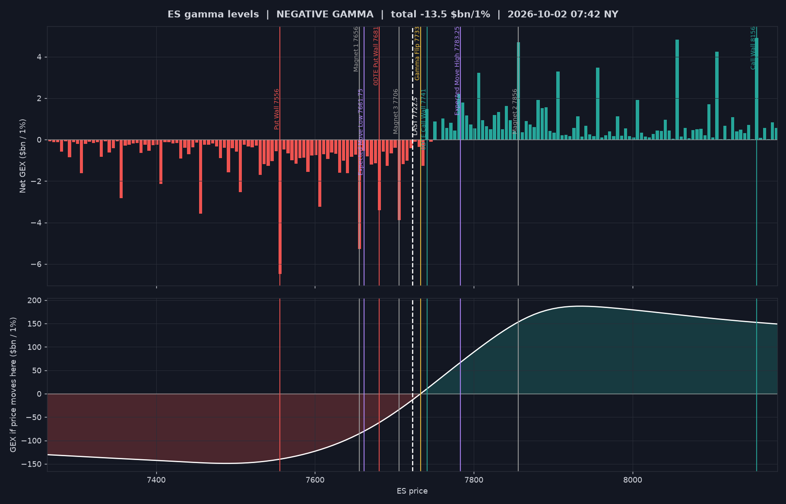
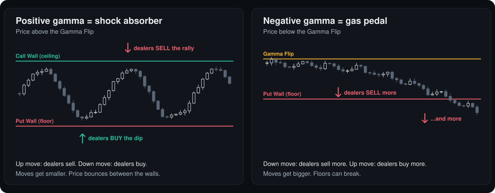
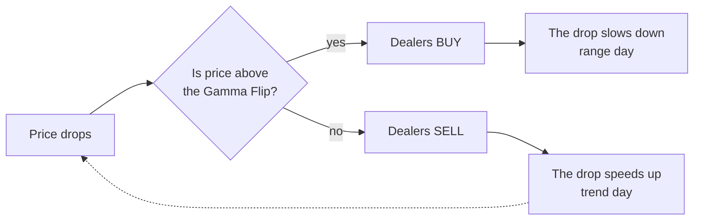
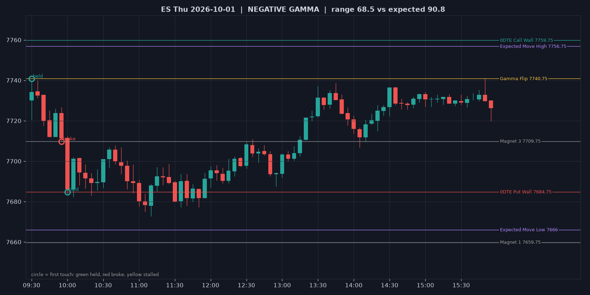
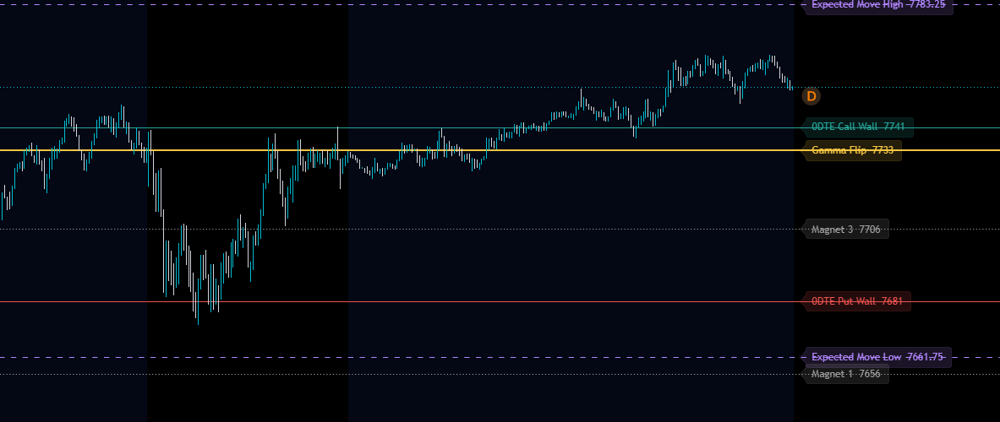
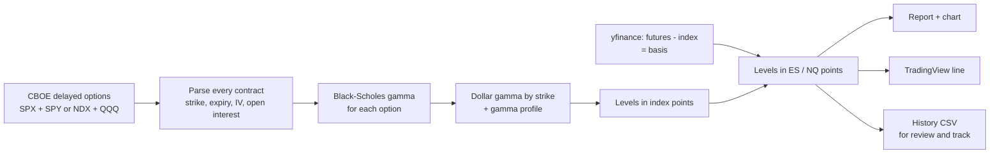

<p align="center">
  
</p>

<p align="center">
  
  
  
  
  <a href="LICENSE"></a>
</p>

<p align="center">
  <b>Where are the big options dealers forced to buy and sell today?</b><br>
  GAMMA answers that every morning for ES and NQ futures. Free data, one command.
</p>

<p align="center">
  <a href="#quick-start">Quick start</a> &middot;
  <a href="#gamma-explained-like-youre-15">Gamma explained</a> &middot;
  <a href="#the-levels">The levels</a> &middot;
  <a href="#a-real-day-october-1-2026">A real day</a> &middot;
  <a href="#tradingview-setup">TradingView</a> &middot;
  <a href="#ninjatrader-setup">NinjaTrader</a> &middot;
  <a href="#commands">Commands</a> &middot;
  <a href="#faq">FAQ</a>
</p>

---

## What you get

| | |
|---|---|
| **Levels in futures prices** | Call Wall, Put Wall, Gamma Flip, Magnets, 0DTE walls and the expected move. They are computed from SPX + SPY (for ES) and NDX + QQQ (for NQ) options and converted to the futures price you actually trade. |
| **A plan, not just numbers** | Every report starts with the **regime**: is today likely calm or wild? Then it gives the rules that usually work in that regime. |
| **TradingView in one paste** | Install the included indicator once. Every morning, paste one line and all levels draw themselves, and failed-breakout trades show up with entry, stop and target, managed bar by bar with phone alerts. |
| **NinjaTrader on autopilot (sim)** | A NinjaTrader 8 strategy reads the levels by itself and trades the failed breakouts on a simulation account: bracket orders, breakeven stop, 2-loss daily limit. It refuses to place orders on real accounts. |
| **Live alerts** | `track.py` prints a line when price touches a level, when the level holds or breaks, each time a 5-minute bar closes back through it, when price crosses the Gamma Flip, and when a wall gives a failed-breakout trade (entry, stop, target). |
| **Proof, not hope** | `review.py` checks your saved levels against what really happened, so you learn which levels work for you. |

<p align="center">
  
</p>

---

## Quick start

```bash
git clone https://github.com/AyourElwazani97/gamma.git
cd gamma
pip install -r requirements.txt
python gex.py ES        # or NQ, or nothing for both
```

Real output from the morning of Friday, October 2, 2026:

```text
=== ES gamma levels (from SPX + SPY options) ===
Data: Fri 2026-10-02 07:42 New York (CBOE, 15-min delayed)
Basis ES - SPX: +56.05 (live, Thu 15:59 NY)
Total GEX: -13.53 $bn per 1% move

REGIME: NEGATIVE GAMMA (price below the Gamma Flip)
  Dealers AMPLIFY moves: expect bigger, faster swings and trends.
  - Don't fade strong moves blindly; trade breaks/retests with the trend.
  - Smaller size, wider stops. Walls can break instead of holding.
  - Reclaiming the Gamma Flip = market usually calms down.

  Level                      ES        SPX    Dist  Meaning
  Call Wall                8156       8100    +434  Biggest resistance: rallies tend to stall or reject here
  Magnet 2                 7856       7800    +134  Price gets pulled here and often pins
  Expected Move High    7783.25     7727.3     +61  Top of the options-implied range for Fri Oct 02
  0DTE Call Wall           7741       7685     +18  Resistance for Fri Oct 02 (that day's expiry only)
  Gamma Flip               7733    7676.93     +10  Regime line: above = calm/ranging, below = fast/trending
  >>> LAST PRICE         7722.5    7666.45       0  <<<
  Magnet 3                 7706       7650     -16  Price gets pulled here and often pins
  0DTE Put Wall            7681       7625     -42  Support for Fri Oct 02 (that day's expiry only)
  Expected Move Low     7661.75     7605.6     -61  Bottom of the options-implied range for Fri Oct 02
  Magnet 1                 7656       7600     -66  Price gets pulled here and often pins
  Put Wall                 7556       7500    -166  Biggest support: if it breaks, selling can speed up

TradingView (paste into the GEX Levels indicator settings):
8156=Call Wall;7856=Magnet 2;7783.25=Expected Move High;7741=0DTE Call Wall;7733=Gamma Flip;...
```

> [!TIP]
> Run it **before the open, after about 06:00 New York time**. Open interest (how many option contracts exist) is only updated once per night, so that is when the day's levels are ready.

---

## Gamma explained like you're 15

Forget the math for a minute. Here is the whole idea in five steps.

**1. Options are like insurance tickets.**
People buy **calls** (a bet that price goes up) and **puts** (protection in case price goes down). Millions of them exist on the S&P 500 and the Nasdaq every day.

**2. Someone has to sell those tickets: the dealers.**
Dealers (market makers) are like the shop that sells the tickets. They don't want to gamble on direction, they want the fee. So they **hedge**: they buy or sell futures to stay neutral, all day long.

**3. Gamma tells you how much hedging they must do when price moves.**
A strike with huge gamma is a price where dealers are forced to trade a lot. That's why price "feels" those strikes.

**4. The twist: depending on where price is, dealers either calm the market down or speed it up.**

<p align="center">
  
</p>

- **Positive gamma = shock absorber.** Price goes up, dealers sell. Price goes down, dealers buy. Like a goalkeeper who always kicks the ball back to the middle. Expect **ranges**.
- **Negative gamma = gas pedal.** Price goes down, dealers sell more, so it goes down even more. Like a snowball rolling downhill. Expect **trends and fast moves**.

**5. So the most important line of the day is the Gamma Flip**, the border between the calm zone and the wild zone.



> [!NOTE]
> Nobody outside the banks can see the dealers' real positions. GAMMA **estimates** them from public open interest, assuming dealers are long calls and short puts. Paid tools like SpotGamma and MenthorQ make the same kind of estimate.

---

## The levels

Colors match the TradingView indicator.

| Level | On the chart | Think of it as | What usually happens | How to use it |
|---|---|---|---|---|
| **Gamma Flip** | yellow, thick | The border between calm land and wild land | Above it: ranges. Below it: trends and fast moves | Check it first every day. Losing it means stop buying dips. Getting back above it means the market usually calms down. |
| **Call Wall** | green | The ceiling | Rallies stall or reject here, especially in positive gamma | Take profit on longs. Look for a short when price gets rejected. |
| **Put Wall** | red | The floor (a trampoline) | Price bounces. In negative gamma a break can drop like an elevator | Buy a **hold**, never a **break**. |
| **0DTE Call / Put Wall** | thin green / red | Today-only ceiling and floor | From options that expire at 16:00 today. Strongest during the day, especially in the afternoon | Intraday targets and fade spots. |
| **Magnets** | gray, dotted | Gravity | Price gets pulled toward them and often "pins" there into the close | Take profits there. Expect chop around them. |
| **Expected Move High / Low** | purple, dashed | The fence | The range option traders paid for today. Most days stay inside it | In positive gamma, fade the edges. In negative gamma, a break can run. |

**Two numbers on top of the report:**
- **Regime**: positive or negative gamma, which tells you whether to fade moves or follow them.
- **Total GEX**: how many billions of dollars dealers must trade for each 1% move. The bigger it is (positive or negative), the stronger the effect.

---

## A real day: October 1, 2026

The levels were printed at **05:58 New York time**, before the open. Here is how ES traded around them (5-minute candles; a circle marks the first touch of each level, green = held, red = broke):

<p align="center">
  
</p>

| Time (ET) | What happened | Level |
|---|---|---|
| 05:58 | The report says **negative gamma**, flip at 7740.75. Plan: don't buy dips, sell failed rallies. | Gamma Flip |
| 09:35 | The opening push stops at **7740.00**, 0.75 points under the flip. | Gamma Flip held |
| 10:00 | ES falls through the magnet at 7709.75 and reaches the **0DTE Put Wall at 7684.75**, then bounces 23 points. | Magnet broke, put wall held |
| 11:10 | Low of the day, 7672.75. | |
| 15:50 | The afternoon rally tops at **7741.25**, right at the flip again. | Gamma Flip held |

**The plan's trade:** short the failed retest of the flip at 7734.25, stop 7748.5. Both targets (7709.75, 7684.75) were hit by 10:00, for **+37 points (+2.6R)**. The NQ trade the same morning was a **loss (−1R)** because the entry came 59 points away from the level. Enter near the level or skip it.

> [!IMPORTANT]
> One good day proves nothing. Run `review.py` every week and build your own statistics before you trust any level with real money.

---

## Your daily routine

| New York time | Do this | Command |
|---|---|---|
| 06:00 to 09:00 | Get today's levels and read the regime | `python gex.py` |
| Before 09:30 | Paste the lines into TradingView | see [TradingView setup](#tradingview-setup) |
| 09:30 to 16:00 | Get alerts when price hits a level | `python track.py` |
| After 16:00 | See which levels held and which broke | `python review.py --detail --charts output/review` |

**Five rules that keep you alive**
1. **Trade the reaction, not the level.** Wait for price to touch it and show you a bounce or a break.
2. **Put your stop beyond the level.** If the level fails, you're out with a small loss.
3. **Enter near the level or skip.** A late entry means a huge stop.
4. **Size by risk (R), not by number of contracts.** Decide how many dollars you can lose per trade first, then pick the size.
5. **On news days (jobs report, CPI, Fed), wait 10 to 15 minutes** after the release before trading. Then watch which level stops the spike.

---

## TradingView setup

**Install once**
1. Open an **`ES1!`** chart (or `NQ1!`).
2. Open the **Pine Editor**, choose **Open → New indicator**, delete the template and paste the contents of [`tradingview/gex_levels.pine`](tradingview/gex_levels.pine).
3. Click **Save**, then **Add to chart**.

**Every morning**
1. Run `python gex.py` and copy the `TradingView` line (it's also saved in `output/ES_tradingview.txt`).
2. Click the **gear** next to *GEX Levels* on your chart, paste the line into **Levels**, click **OK**.

<p align="center">
  
</p>

| Color | Level |
|---|---|
| Green | Call walls |
| Red | Put walls |
| Yellow | Gamma Flip |
| Purple, dashed | Expected move |
| Gray, dotted | Magnets |

**Failed-breakout trades on the chart.** On a 5-minute chart the indicator also runs the failed-breakout rules from `track.py` on today's session and manages each trade bar by bar:

- a blue label at the signal with the plan (entry, stop, target, when to move the stop to breakeven) and `OK` or `SKIP` with the reason
- blue entry, red stop and green target lines; the stop line moves to the entry once price goes one risk in your favour
- a label when the trade ends: `TARGET`, `STOPPED`, `SCRATCH at breakeven` or `FLAT at session end`, with points and dollars per contract (MES $5, ES $50, MNQ $2, NQ $20 a point)
- one trade at a time, an unfilled entry is cancelled after 30 minutes, and after 2 losing trades it stops for the day
- a panel in the top right: the regime, today's score and what to do now

For phone alerts: **Alerts → Create**, condition **GEX Levels → Any alert() function call**. You get a message for each new trade, fill, move to breakeven and exit.

The indicator does not place orders. When it says `SHORT below 7863.25, stop 7876, target 7849.5`, place a sell stop at 7863.25 as a **bracket order** with the stop and target attached, so they are in the market the moment you are filled. Settings let you change the session, the cancel time and the loss limit.

---

## NinjaTrader setup

[`ninjatrader/GexFailedBreakout.cs`](ninjatrader/GexFailedBreakout.cs) is a NinjaTrader 8 strategy with the same failed-breakout rules, that **trades them for you on a simulation account**. It reads the levels straight from `history/levels_history.csv`, so there is nothing to paste.

**Install once**
1. Copy `GexFailedBreakout.cs` into `Documents\NinjaTrader 8\bin\Custom\Strategies`.
2. In NinjaTrader: **New → NinjaScript Editor**, then press **F5** to compile.

**Every day**
1. Run `python gex.py` (as always).
2. Open a **5-minute** chart of ES, MES, NQ or MNQ. Micros use the full contract's levels.
3. **Strategies → GexFailedBreakout**, account **Sim101** (or your own sim account), **Enabled**.

**What it does on a signal it rates OK**
- a sell stop / buy stop entry with the stop loss and target attached (a bracket), all placed by NinjaTrader
- moves the stop to the entry once price goes one risk in your favour
- cancels an entry that isn't filled within 30 minutes, trades one setup at a time, stops for the day after 2 losses and is flat at 16:00
- draws the levels, the signal with its plan, the entry/stop/target lines and each result, plus a panel with today's score; NinjaTrader alerts and the Output window tell you each step

**Safety:** it only sends orders to **simulation accounts**: NinjaTrader's own Sim accounts, Playback, or any connection in **Simulation** mode. On a **Live** connection (real money) it draws and alerts but never places an order. A broker **demo** account (for example NinjaTrader's `DEMO...` accounts) is not marked as simulation, so it only gets orders if you type its exact name in the strategy's **Allowed demo account** setting. Never type a real-money or prop-firm account there. The panel's last line always names the account and whether orders are on.

**Data:** the strategy needs real 5-minute ES/NQ prices. *Kinetick End Of Day* only has daily bars and the *Simulated Data Feed* invents prices, so for live use you need a real-time connection. With the **Playback Connection** you can replay past sessions (downloaded Market Replay data) on the Playback101 account and watch it trade, faster than real time.

The strategy is checked by `tests/test_ninjatrader.py` (runs where NinjaTrader 8 is installed): it compiles against NinjaTrader's own assemblies and finds exactly the same setups as `gex/fakeouts.py` on every saved session.

---

## Commands

<details>
<summary><b><code>gex.py</code></b>: today's levels, chart, TradingView line, history</summary>

```bash
python gex.py                   # ES and NQ
python gex.py ES                # one product
python gex.py ES --basis 59.5   # set the ES - SPX gap yourself (another contract month, or yfinance is down)
python gex.py --no-etf          # index options only (skip SPY / QQQ)
python gex.py --show            # open the chart when done
python gex.py --from-dir DIR    # use saved CBOE files (DIR/_SPX.json ...) instead of downloading
python gex.py --no-history      # don't log this run
```

Writes `output/ES_<date>.png`, `output/ES_tradingview.txt` and adds a row to `history/levels_history.csv`.

Below the ladder it prints the **prior session's volume profile** and the levels that sit on it:

```text
Wed Oct 14 volume profile: POC 7767.75, VAH 7807.75, VAL 7744.75
  Confluence: Put Wall 7746.5 ~ VAL 7744.75 (1.75 away) | Expected Move Low 7744 ~ VAL 7744.75 (0.75 away)
```

POC is the price with the most volume, VAH / VAL the edges of the value area (70% of the volume). A GEX level within 0.06% (about 5 ES / 18 NQ points) of one of them has two reasons to matter: options hedging and traded volume. The profile is built from 5-minute bars (each bar's volume spread over its range), the same way FreeOrderFlow computes its value area; on Oct 14, 2026 it came within 0.5-2 ES points of NinjaTrader's tick-based profile.
</details>

<details>
<summary><b><code>track.py</code></b>: live alerts during the session</summary>

```bash
python track.py                 # ES and NQ from the 09:30 open, checks every 2 minutes
python track.py --start 08:25   # include the pre-market (jobs report days)
python track.py ES --interval 60
```

Alerts from a replay of October 1, 2026:

```text
TRACKING ES, NQ from 09:30 ET, checking every 120s
09:30 ES touched Gamma Flip 7740.75 as resistance (last 7734.25)
09:30 NQ touched Magnet 3 30846.5 as resistance (last 30809.75)
ES Gamma Flip 7740.75 HELD: bounced 9.5 pts (last 7732.5)
NQ Magnet 3 30846.5 HELD: bounced 106 pts (last 30802.5)
09:45 NQ touched 0DTE Call Wall + Magnet 1 30726.5 as support (last 30708.5)
NQ 0DTE Call Wall + Magnet 1 30726.5 HELD: bounced 63.5 pts (last 30786)
09:55 ES touched Magnet 3 7709.75 as support (last 7711.25)
ES Magnet 3 7709.75 BROKE: went 26 pts through (last 7686)
10:00 ES touched 0DTE Put Wall 7684.75 as support (last 7686)
ES 0DTE Put Wall 7684.75 HELD: bounced 17.25 pts (last 7701.25)
```

**Crossing alerts.** The touch line only covers the first time price reaches a level. After that, every 5-minute bar that closes on the other side of a level prints a line (closes within about 1.5 ES / 6 NQ points of the level don't count). From October 13, 2026:

```text
10:50 NQ closed back BELOW Expected Move Low 30719.25 at 30696.5 (cross #2 today, last 30683.25)
10:30 ES closed back BELOW Magnet 3 7849.5 at 7846.5 (cross #2 today, last 7841.25)
10:40 ES closed back ABOVE Magnet 3 7849.5 at 7852 (cross #3 today, last 7841.25)
```

A high cross count at a magnet means price is pinned there: chop, not a trend.

**Failed-breakout alerts** (Tom Hougaard's "magnet" trade). Price pushes through a wall or an expected-move edge, can't follow through, and closes back inside within 15 minutes. That is the signal to trade back toward the next level:

- only tops of the range give shorts (Call Walls, Expected Move High) and only bottoms give longs (Put Walls, Expected Move Low)
- entry = break of the signal bar's low (short) or high (long), stop = beyond the furthest point of the push, target = the next level
- once price reaches the `at` price (one risk in your favour), move the stop to your entry: the trade can no longer lose
- `OK` only in positive gamma with a reward at least as big as the risk; otherwise the line says `SKIP` and why

Alerts from a replay of October 8, 2026:

```text
10:30 NQ FAILED BREAKOUT above Expected Move High 31355.75: SHORT below 31331.75, stop above 31369.75, target 0DTE Put Wall 31269.75 (risk 38, reward 62), at 31293.75 move stop to 31331.75 -> OK: positive gamma, walls tend to hold
12:05 ES FAILED BREAKDOWN below 0DTE Put Wall 7822: LONG above 7825.25, stop below 7820, target Magnet 3 7852 (risk 5.25, reward 26.75), at 7830.5 move stop to 7825.25 -> OK: positive gamma, walls tend to hold
13:05 ES FAILED BREAKDOWN below Expected Move Low 7799: LONG above 7805.75, stop below 7796.75, target 0DTE Put Wall 7822 (risk 9, reward 16.25), at 7814.75 move stop to 7805.75 -> SKIP: below Gamma Flip, walls break more often
```

The NQ short reached its target. The ES long came within 2 points of its target, then fell back, so the breakeven stop turned a loss into a scratch. This is a heads-up, not a proven system yet: only a handful of sessions are logged.

**Second touch of a 0DTE wall (test setup).** Price often comes back to a 0DTE wall two or three times. When the first touch bounces at least 0.1% and a second touch closes back on the same side within 15 minutes, the tracker prints `2ND TOUCH of ...` with the same kind of plan (entry on the break of that bar, stop beyond the retest, next level as target). It is marked `TEST setup, not proven: paper-trade only` in every regime until the setup scoreboard in `review.py` shows it earns its place.

The alert also says whether the second touch has an **RSI divergence**: the retest goes as far as the first touch or further (an equal or lower low at support, an equal or higher high at resistance) while RSI(14) on the 5-minute closes does not (a higher RSI at support, a lower one at resistance). That's a sign the sellers or buyers are running out at the wall. Example: `2ND TOUCH of 0DTE Put Wall 7719 with RSI divergence (RSI 31 -> 38)`.
</details>

<details>
<summary><b><code>review.py</code></b>: how did the levels do?</summary>

```bash
python review.py                                  # summary for ES and NQ
python review.py ES --detail                      # level-by-level reactions for each session
python review.py --detail --charts output/review  # plus a 5-minute chart per session
```

For every level it reports the first touch, whether it was tested as support or resistance, and whether price
**held** (moved 0.1% away) or **broke** (moved 0.1% through) within 60 minutes. It ends with a scorecard per level type and a **setup scoreboard**: every failed breakout and 0DTE second touch of every saved session, paper-traded with the strategy's rules (stop entry, stop, target, stop to entry after one risk, cancel after 30 minutes), in R (multiples of each trade's risk), for all setups, the ones `track.py` calls OK, and the ones below the Gamma Flip. Second touches with an RSI divergence get their own row, `2nd touch + RSI divergence`. Before it, a small table compares first touches of the levels near the prior session's volume profile with the other levels, to see whether that confluence makes a level hold more often.
yfinance keeps 5-minute bars for only about 60 days, so `review.py` saves each finished session (from 18:00 the evening before to the 16:00 close) to `history/bars/ES_<date>.csv` and reads it from there next time. Run it at least once a month and commit `history/` so every logged day stays testable.
</details>

---

## How it works



<details>
<summary>The math, for the curious</summary>

- **Dollar gamma per option** = gamma × open interest × contract multiplier × price² × 1%. Calls count positive, puts negative (dealers assumed long calls, short puts).
- **Gamma** is recomputed with Black-Scholes from each option's implied volatility. Rates and dividends are set to zero, and time to expiry has a 1-hour floor.
- **SPY / QQQ** options are scaled into SPX / NDX points: strike × ratio, multiplier ÷ ratio. That keeps each option's dollar gamma unchanged.
- **Call Wall / Put Wall** = the strikes with the most positive / most negative **net** gamma within ±15% of price. Net, because round strikes like SPX 8000 carry huge offsetting call and put open interest.
- **Gamma Flip** = where the total gamma, recomputed at 201 prices within ±10%, crosses zero (the crossing nearest to price).
- **Magnets** = the three biggest absolute-gamma strikes within ±2% of price.
- **Expected move** = price ± the at-the-money straddle of the nearest expiry.
- **Basis** = futures minus index, the median of the last 15 shared 1-minute bars.
</details>

---

## Limits

> [!WARNING]
> - These are **estimates** from public data, not the dealers' real books.
> - Open interest updates **once per day**. Today's new 0DTE positions are not in it.
> - CBOE data is **15 minutes delayed**.
> - The report uses the last index close for the regime. Before the open, compare the **live** futures price with the Gamma Flip yourself.
> - Levels are context, not buy/sell signals. All example trades are hypothetical replays.
> - **Nothing here is financial advice.** Futures can lose more than you put in.

---

## FAQ

<details>
<summary><b>Why are my levels different from SpotGamma or MenthorQ?</b></summary>

Every service uses its own assumptions: which options are included, how dealers are positioned, how walls are defined. Expect similar areas, not identical numbers. The levels that matter most (big round strikes, the flip area) usually line up.
</details>

<details>
<summary><b>The report says negative gamma, but price is above the flip. Which is right?</b></summary>

Trust the live price. The regime line in the report is computed at the last index close. If futures traded overnight and are now above the Gamma Flip, the market is in positive gamma.
</details>

<details>
<summary><b>What is the "basis"?</b></summary>

ES and SPX don't trade at the same price. ES is usually a bit higher because of interest rates and dividends. GAMMA measures that gap (for example +56 points) and adds it to every level, so the levels match your ES chart. If you trade a different contract month, set it yourself with `--basis`.
</details>

<details>
<summary><b>Does it work on weekends?</b></summary>

Yes. It uses Friday's data, and the 0DTE levels are for Monday's expiry.
</details>

<details>
<summary><b>Can I use it for SPY, QQQ or single stocks?</b></summary>

Not yet. Products are defined in `gex/config.py`, so adding one means a new entry with its option tickers and futures symbol.
</details>

---

## Project structure

```text
gex.py              today's levels           ->  gex/cli.py
track.py            live alerts              ->  gex/track.py
review.py           how did the levels do?   ->  gex/review.py
gex/
  config.py         products (ES, NQ)
  data.py           download + parse CBOE option chains
  greeks.py         Black-Scholes gamma
  levels.py         walls, flip, magnets, expected move
  futures.py        index -> futures basis
  reactions.py      held / broke / stalled at each level
  fakeouts.py       failed breakouts at walls (Tom Hougaard's setup)
  bars.py           saved 5-minute bars per session
  retests.py        second touch of a 0DTE wall (test setup)
  paper.py          paper-trades a setup bar by bar
  profile.py        volume profile from 5-minute bars, levels near it
  output.py         report, chart, TradingView line, history CSV
tradingview/        GEX Levels indicator (Pine Script v6)
ninjatrader/        GexFailedBreakout strategy (NinjaScript), trades the setups on a sim account
history/            your daily levels log, plus bars/ (5-minute bars of each finished session)
tests/              140 tests (python -m pytest)
legacy/             the original 2022-2024 scripts
```

**Run the tests**

```bash
python -m pytest
```

Contributions are welcome. Open an issue first for bigger changes, and keep tests passing.

---

## License

[MIT](LICENSE): free to use, change and share. The software comes with no warranty, and nothing in it is financial advice.
